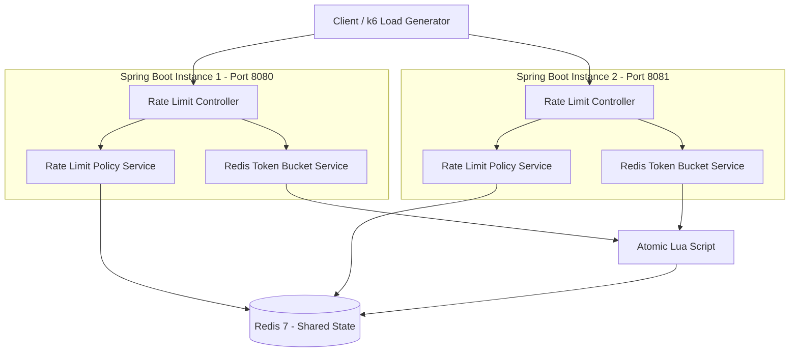

# Distributed Rate Limiter

A distributed, Redis-backed API rate limiter built using **Java 21, Spring Boot, Redis, and Docker**.

The project implements the **Token Bucket algorithm** with atomic Redis Lua script execution to enforce rate limits consistently across multiple Spring Boot instances.

The goal is to demonstrate practical backend engineering concepts, including distributed state management, concurrency control, caching, observability, containerization, automated testing, and performance benchmarking.

## Key Features

- **Token Bucket algorithm** for controlling request rates.
- **Distributed rate limiting** using shared Redis state.
- **Atomic operations** using Redis Lua scripts to prevent race conditions.
- **Configurable rate-limit policies** with capacity and refill rate.
- **Multiple application instances** sharing the same Redis state.
- **HTTP 429 responses** when a request exceeds its limit.
- **Rate-limit response headers**, including `X-RateLimit-Limit`, `X-RateLimit-Remaining`, and `Retry-After`.
- **Redis failure strategies** supporting fail-open and fail-closed behavior.
- **Prometheus metrics** through Spring Boot Actuator and Micrometer.
- **Concurrent request testing** and cross-instance integration testing.
- **Docker Compose** for running the complete environment.
- **GitHub Actions CI** for automated build and test execution.
- **k6 performance benchmarking** at different virtual-user loads.

## Architecture



Both application instances use the same Redis server. This allows them to enforce a shared rate limit for a user, rather than maintaining independent in-memory counters.

The diagram represents direct requests to two application instances; it does not imply that a load balancer is deployed.

## Technology Stack

| Technology | Purpose |
|---|---|
| Java 21 | Backend programming language |
| Spring Boot 4.1.2 | Application framework |
| Spring Data Redis | Redis integration |
| Redis 7 | Shared distributed state |
| Redis Lua | Atomic Token Bucket execution |
| Maven | Build and dependency management |
| Docker | Application containerization |
| Docker Compose | Multi-container orchestration |
| Micrometer | Application metrics |
| Prometheus | Metrics exposition |
| Spring Boot Actuator | Health and monitoring endpoints |
| JUnit / Mockito | Unit and integration testing |
| k6 | Load and performance testing |
| GitHub Actions | Continuous integration |
| Postman | API testing |

## How It Works

### 1. Token Bucket Algorithm

The Token Bucket algorithm maintains a bucket containing a limited number of tokens.

- Each bucket has a maximum capacity.
- Incoming requests consume one token.
- Tokens are replenished at a configured rate.
- If at least one token is available, the request is allowed.
- If no token is available, the request is rejected.

For example, consider a bucket with:

- Capacity: 5 tokens
- Refill rate: 1 token per second

The first five requests can be accepted immediately. Additional requests are rejected until tokens become available again.

### 2. Distributed Rate Limiting

An in-memory rate limiter cannot reliably enforce a shared limit across multiple application instances because each instance maintains separate state.

This project uses Redis as the shared state store.

Both Spring Boot instances access the same bucket associated with a user identifier.

### 3. Atomic Redis Execution

The Token Bucket operation is implemented using a Redis Lua script.

The script performs the following operations atomically:

1. Retrieves the current bucket state.
2. Reads the Redis server time.
3. Calculates newly available tokens.
4. Updates the bucket state.
5. Determines whether the request is allowed.
6. Calculates the retry delay when rejected.

Executing these operations atomically prevents concurrent requests from independently reading and consuming the same available token.

### 4. Redis Key Structure

The application uses the following Redis key patterns:

**Rate-limit policy**

```text
rate_policy:USER:{userId}
```

**Token bucket state**

```text
rate_limit:USER:{userId}
```

The policy stores configuration such as plan, capacity, and refill rate. The bucket stores the current token count and last refill timestamp.

## API Documentation

### Access a protected resource

| Property | Value |
|---|---|
| Method | GET |
| Endpoint | `/api/resource` |
| App instance 1 | `http://localhost:8080` |
| App instance 2 | `http://localhost:8081` |
| Required header | `X-User-Id` |

**Example request**

```bash
curl -i http://localhost:8080/api/resource \
  -H "X-User-Id: user-123"
```

**Successful response**

```http
HTTP/1.1 200 OK
```

```text
Request allowed!
```

**Rate-limit exceeded**

```http
HTTP/1.1 429 Too Many Requests
X-RateLimit-Limit: 5
X-RateLimit-Remaining: 0
Retry-After: 1
```

```text
Rate limit exceeded!
```

The header values above are illustrative; actual values depend on the configured policy and bucket state.

### Redis failure behavior

The application supports two Redis failure strategies:

| Strategy | Behavior |
|---|---|
| Fail-open | Allows the request when Redis is unavailable |
| Fail-closed | Rejects processing with HTTP 503 when Redis is unavailable |

Configure the strategy using:

```yaml
rate-limiter:
  redis:
    failure-strategy: fail-open
```

The strategy can also be configured through the environment variable:

```text
RATE_LIMITER_REDIS_FAILURE_STRATEGY
```

## Running the Project

### Prerequisites

- Java 21
- Docker Desktop or Docker Engine
- Git
- Postman (optional)
- k6 (optional, for load testing)

### 1. Clone the repository

```bash
git clone https://github.com/bhagwatlipne2004/distributed-rate-limiter.git

cd distributed-rate-limiter
```

### 2. Build the application

On Windows PowerShell:

```powershell
.\mvnw.cmd clean package
```

On Linux/macOS:

```bash
./mvnw clean package
```

### 3. Build the Docker image

```bash
docker build -t distributed-rate-limiter:1.2 .
```

### 4. Start the complete environment

```bash
docker compose up -d
```

Docker Compose starts:

| Container | Port |
|---|---:|
| Spring Boot instance 1 | 8080 |
| Spring Boot instance 2 | 8081 |
| Redis | 6379 |

### 5. Verify application health

```bash
curl http://localhost:8080/actuator/health
```

```bash
curl http://localhost:8081/actuator/health
```

### 6. Test the API

```bash
curl -i http://localhost:8080/api/resource \
  -H "X-User-Id: user-123"
```

Send another request to the second instance using the same user ID:

```bash
curl -i http://localhost:8081/api/resource \
  -H "X-User-Id: user-123"
```

Both instances share the same Redis-backed rate-limit state.

### 7. Stop the environment

```bash
docker compose down
```

To also remove the Redis persistent volume:

```bash
docker compose down -v
```

**Warning:** The `-v` option deletes the persisted Redis data.


## Testing

The project includes unit, integration, Redis, and concurrency tests.

### Prerequisites

Before running the complete test suite:

1. Start the Docker Compose environment:

```powershell
docker compose up -d
```

2. Configure the test policy in Redis:

```powershell
docker exec rate-limiter-redis redis-cli HSET rate_policy:USER:distributed-integration-test plan FREE capacity 5 refillRate 0.000001
```

3. Run the automated tests:

On Windows PowerShell:

```powershell
.\mvnw.cmd clean test
```

On Linux/macOS:

```bash
./mvnw clean test
```

### Test coverage areas

- Token Bucket algorithm behavior.
- Bucket capacity and token refill.
- Rate-limit policy validation.
- Redis-backed token consumption.
- Concurrent request handling.
- Distributed rate limiting across two application instances.
- Redis failure handling.
- Fail-open and fail-closed behavior.

### Concurrent testing

The concurrency test uses 100 workers against a bucket configured with a capacity of 10 tokens.

Expected result:

| Result | Expected |
|---|---:|
| Allowed requests | 10 |
| Rejected requests | 90 |
| Total requests | 100 |

### Postman collection

Import the collection:

```text
postman/distributed-rate-limiter.postman_collection.json
```

It verifies successful requests, rate-limit rejection, response headers, and cross-instance rate limiting.

Some test scenarios require Redis to be running and the test user's bucket to be reset before execution.

## Monitoring and Observability

Spring Boot Actuator and Micrometer expose application health and metrics.

**Health endpoint**

```text
GET /actuator/health
```

**Prometheus metrics**

```text
GET /actuator/prometheus
```

Custom metrics include:

| Metric | Description |
|---|---|
| `rate_limiter_requests_allowed_total` | Allowed requests |
| `rate_limiter_requests_rejected_total` | Rejected requests |
| `rate_limiter_redis_failures_total` | Redis failures |
| `rate_limiter_request_duration_seconds` | Request processing duration |

These metrics help monitor request behavior, Redis availability, and application performance.

## Performance Benchmarking

The project uses [k6](https://k6.io/) to evaluate performance at different virtual-user loads.

### Benchmark configuration

- 100 virtual users
- 500 virtual users
- 1,000 virtual users
- Single-instance and two-instance configurations

### Recorded results

| Configuration | Virtual users | Throughput | Average latency | P95 latency |
|---|---:|---:|---:|---:|
| Single instance | 100 | 5,337 RPS | 14.28 ms | 26.86 ms |
| Single instance | 500 | 6,960 RPS | 55.37 ms | 83.56 ms |
| Single instance | 1,000 | 4,109.5 RPS | 187.94 ms | 422.01 ms |
| Two instances | 1,000 | 6,902.7 RPS | 111.87 ms | 177.03 ms |

The final two-instance benchmark also recorded:

- P99 latency: 209.08 ms
- Maximum latency: 789.69 ms
- HTTP failures: 0
- Configured P95 and P99 thresholds passed.

**Important:** These are measurements from a local test environment, not production capacity guarantees. Results depend on hardware, Docker resources, Redis performance, and workload characteristics. Repeated controlled benchmarks are needed for reliable comparisons.

Detailed results and methodology:

[`docs/performance-benchmark.md`](docs/performance-benchmark.md)

## Continuous Integration

GitHub Actions runs the automated CI workflow on configured pushes and pull requests.

The workflow:

1. Sets up Java 21.
2. Builds the Docker image.
3. Starts the Docker Compose environment.
4. Waits for application health checks.
5. Runs automated tests, including distributed integration tests.
6. Collects container logs if a failure occurs.
7. Stops the test environment.

Workflow configuration:

```text
.github/workflows/ci.yml
```

## Documentation

Additional project documentation:

- [Architecture](docs/architecture.md)
- [API Documentation](docs/api.md)
- [Performance Benchmark Report](docs/performance-benchmark.md)

## Project Structure

```text
distributed-rate-limiter/
│
├── .github/
│   └── workflows/
│       └── ci.yml
│
├── docs/
│   ├── architecture.md
│   ├── api.md
│   └── performance-benchmark.md
│
├── postman/
│   └── distributed-rate-limiter.postman_collection.json
│
├── scripts/
│   ├── load-test.js
│   └── test-redis-failure.ps1
│
├── src/
│   ├── main/
│   │   ├── java/
│   │   │   └── in/ratelimiter/
│   │   └── resources/
│   │       └── scripts/
│   │           └── token_bucket.lua
│   │
│   └── test/
│       └── java/
│           └── in/ratelimiter/
│
├── .dockerignore
├── .gitignore
├── Dockerfile
├── docker-compose.yml
├── pom.xml
└── README.md
```

## Engineering Challenges Addressed

This project explores several real-world backend engineering problems:

- Maintaining consistent rate limits across multiple application instances.
- Preventing race conditions during concurrent token consumption.
- Executing state transitions atomically with Redis Lua.
- Handling Redis outages with configurable failure strategies.
- Measuring application performance under concurrent workloads.
- Monitoring request outcomes and infrastructure failures.
- Automating integration tests and CI execution.

## Future Improvements

Potential extensions include:

- Integrating a reverse proxy or load balancer.
- Adding authentication and API-key-based rate limiting.
- Adding distributed tracing.
- Introducing configurable policy management APIs.
- Running benchmarks on a dedicated environment.
- Adding deployment and infrastructure automation.

## Author

**Bhagwat Balabhau Lipne**

- GitHub: [bhagwatlipne2004](https://github.com/bhagwatlipne2004)
- LinkedIn: [Bhagwat Lipne](https://www.linkedin.com/in/bhagwat-lipne-035a4a321/)

---

*Built to explore distributed systems concepts and production-oriented backend engineering with Java, Spring Boot, and Redis.*