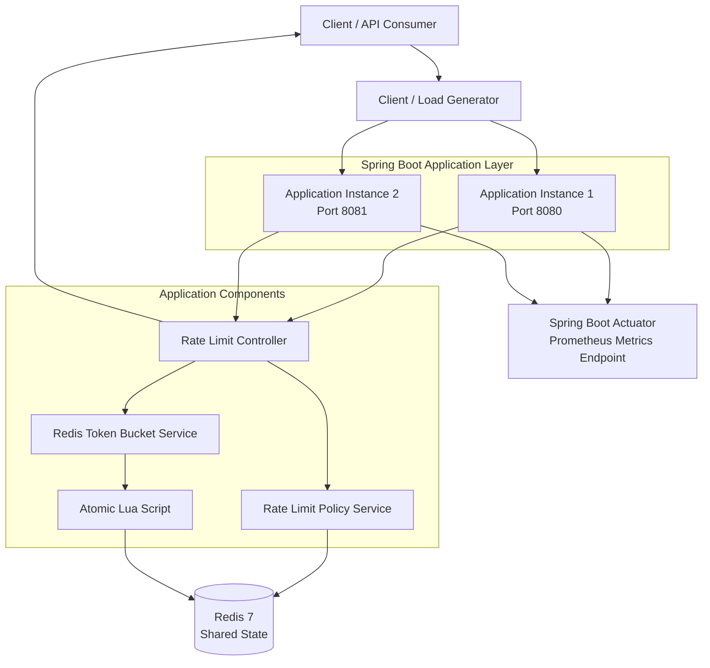

# Distributed Rate Limiter — System Architecture

## 1. High-Level Architecture



## 2. Request Lifecycle

1. Client sends an HTTP request to `/api/resource`.
2. Client provides its identifier through the `X-User-Id` header.
3. The request reaches a Spring Boot application instance.
4. The Rate Limit Controller retrieves the user's rate-limit policy.
5. The Rate Limit Policy Service retrieves the policy from Redis.
6. The Redis Token Bucket Service executes the Lua script.
7. Redis executes the token bucket operation atomically.
8. The script determines whether the request is allowed.
9. The controller returns the corresponding HTTP response.

## 3. Token Bucket Execution

The token bucket algorithm maintains:

- Bucket capacity
- Current available tokens
- Last refill timestamp
- Token refill rate

The Lua script performs the following operations:

1. Reads the current Redis bucket state.
2. Retrieves Redis server time.
3. Calculates newly generated tokens.
4. Updates the available token count.
5. Checks whether the request can be accepted.
6. Updates the bucket state.
7. Returns the decision and remaining token information.

Redis executes the script atomically, preventing concurrent application instances from independently modifying the same bucket state.

## 4. Redis Data Organization

The application uses separate Redis keys for policies and bucket state.

### Rate-limit policy

```text
rate_policy:USER:{userId}
```

Stores:

- plan
- capacity
- refillRate

### Token bucket state

```text
rate_limit:USER:{userId}
```

Stores:

- tokens
- last_refill_timestamp

Both application instances access the same Redis database.

## 5. HTTP Response Handling

| Condition | HTTP Status |
|---|---|
| Request allowed | 200 OK |
| Rate limit exceeded | 429 Too Many Requests |
| Redis unavailable with fail-closed | 503 Service Unavailable |
| Redis unavailable with fail-open | Request allowed |

Rate-limit response headers include:

- `X-RateLimit-Limit`
- `X-RateLimit-Remaining`
- `Retry-After` when rejected

## 6. Distributed Architecture

The application is stateless with respect to shared token bucket state.

Both Spring Boot instances use Redis as the shared storage layer.

This provides:

- Consistent rate-limit enforcement across instances.
- Shared token bucket state.
- Atomic concurrent updates.
- Horizontal application scaling.

## 7. Observability

Spring Boot Actuator exposes application metrics through:

```text
/actuator/prometheus
```

Custom metrics include:

- `rate_limiter_requests_allowed_total`
- `rate_limiter_requests_rejected_total`
- `rate_limiter_redis_failures_total`
- `rate_limiter_request_duration_seconds`

These metrics help monitor request decisions, Redis failures and request processing latency.
```